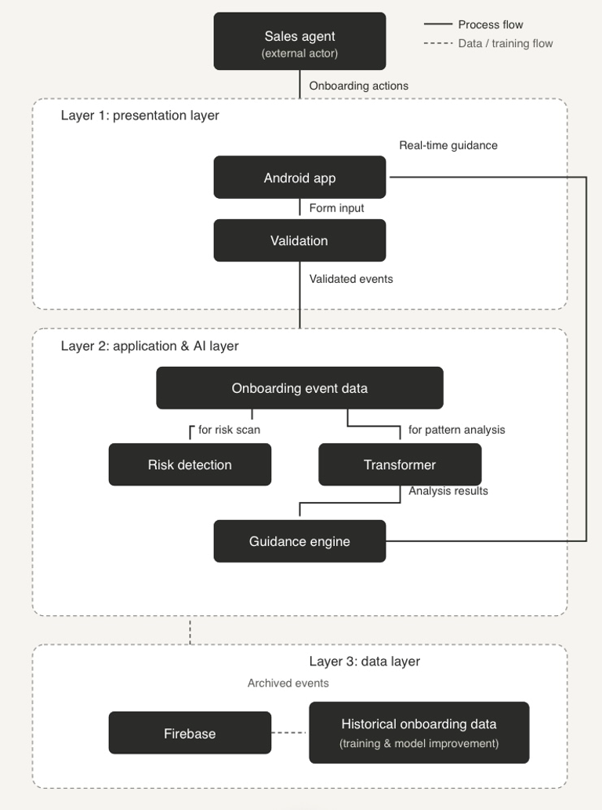

# 1. Project overview

SalesMesh is an Android assistant for customer onboarding. It helps a sales
agent collect customer information, validates entries, predicts the next field,
and warns when a session may become difficult to complete.

## Main flow

1. The agent signs in and selects an industry.
2. The app displays onboarding fields.
3. Entries are validated as they are typed.
4. The TensorFlow Lite model recommends the next field.
5. Risk scoring provides guidance when a session shows difficulty signals.
6. Firebase stores the session, entries, validations, and events.

## Architecture

The Android app owns the user experience and validation. The model predicts
the next field from the completed-field history. Firebase stores operational
session data for retrieval and evaluation.
