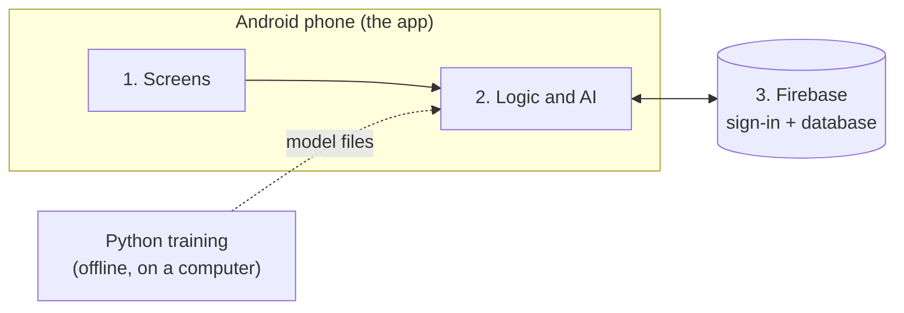

# System architecture

SalesMesh is **an Android app plus Firebase**, Google's ready-made cloud service.
There is no server of our own. The AI runs on the phone.

## Overview



## The parts

| Part | What it is in SalesMesh | Technology |
| --- | --- | --- |
| **Client (user interface)** | The screens agents and admins use | Kotlin, Jetpack Compose |
| **Business logic** | Answer checks, progress, next-question suggestion, risk warning, consistency measure. Runs on the phone. | Kotlin, TensorFlow Lite |
| **Data storage** | Sessions, answers, agents, settings. One branch per company. | Firebase Realtime Database |
| **Security** | Sign-in, company walls, access rules | Firebase Authentication and rules |
| **Infrastructure** | Google runs the cloud side. The agent's phone runs the app. | Firebase |
| **AI training** | Makes simulated data and trains the two models. Not part of the app. | Python |

Left out on purpose: a separate server, API gateway and message queue. Firebase
handles those jobs, so there is nothing of our own to run.

## Layers inside the app

Each layer only calls the one below it.

| Layer | Does | Files |
| --- | --- | --- |
| 1. Presentation | Shows screens, takes taps and typing | `Auth`, `AgentScreens`, `OnboardingForm`, `FormQuestions`, `SessionHistoryScreen`, `AdminScreens`, `AdminOverview`, `Ui` |
| 2. Logic | Checks answers, suggests the next question, works out risk and consistency | `OnboardingController`, `Fields`, `Validation`, `Insights`, `NextFieldPredictor` |
| 3. Data | Saves and loads from Firebase, holds the model files | `FirebaseFieldEntryStore`, `AdminDataStore` |

Code is in `android/app/src/main/java/com/example/salesonboarding/`.

## What is stored

```
companies/{companyId}/
    settings, agentInvitations, fieldRuleOverrides, fieldDefinitions
    onboardingSessions/{sessionId}/  answers, checks, consent time, frozen question list
companyMemberships/{agentUid}        which company each agent belongs to
```

Not saved: the ID photo and the text read from it.

## Security

- Everyone signs in. Admins carry an admin and company mark.
- Agents join only with an email an admin invited.
- Database rules keep each company to its own branch, and agents to their own sessions.
- Seven compliance questions can never be made optional.

Still to do before real data: deploy the tested rules to your Firebase project, turn on email verification,
decide how long data is kept. See the [README](../README.md#known-limits).

## More detail

- [How the app works](02-how-the-app-works.md): screens and saved data
- [AI, data and results](03-ai-data-and-results.md): the models
