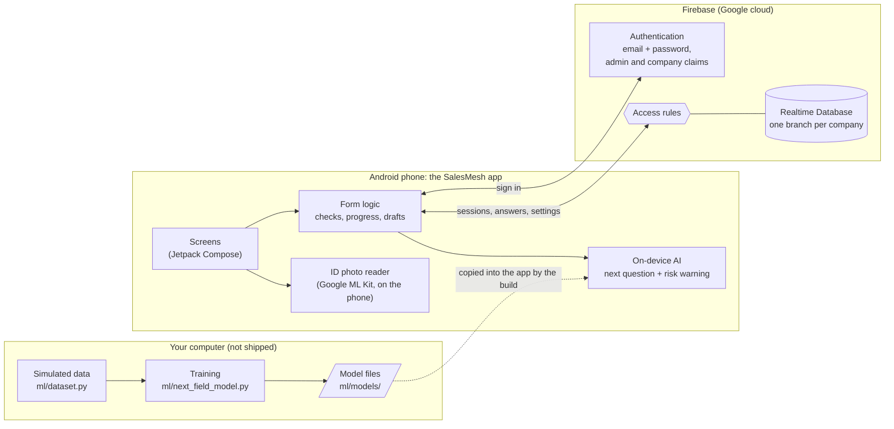
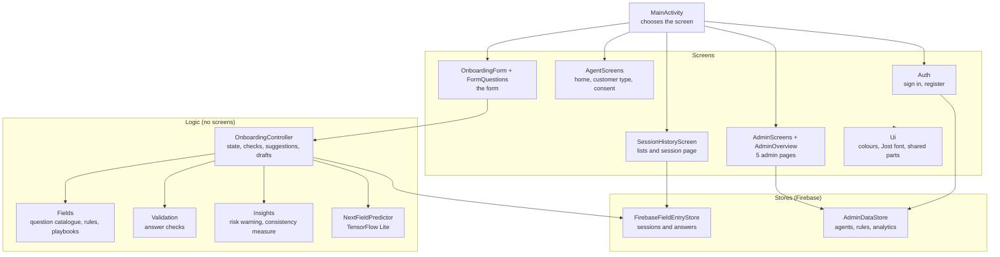
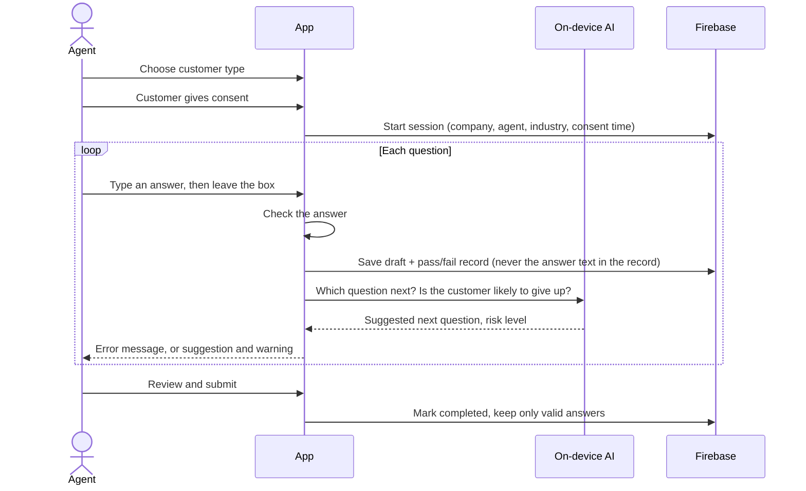
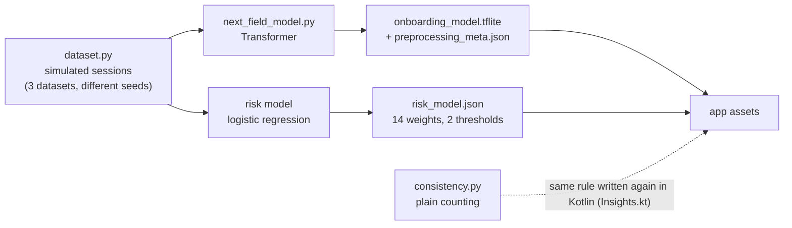
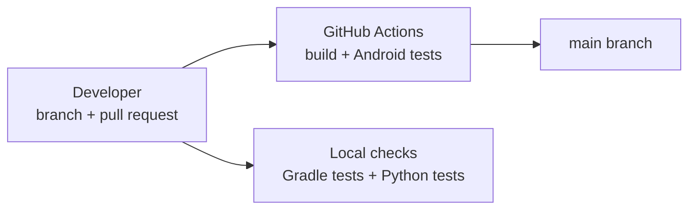

# 04 - System architecture

How the parts of SalesMesh fit together. The diagrams are written in Mermaid, so
GitHub draws them on this page.

## 1. The big picture

There is one phone app and one cloud database. The AI runs **on the phone**, so a
customer's answers never leave the device to be scored. The Python side is only
used offline, to make data and train the models.



## 2. Who uses it

| Person | What they do | What they can see |
| --- | --- | --- |
| **Sales agent** | Onboards customers with the form | Only their own sessions |
| **Admin** | Manages agents, questions and industry; reads results | Everything in their own company, nothing from other companies |
| **Project owner** | Creates the first admin (sets the admin and company claims in Firebase) | The Firebase console |

## 3. Inside the app

One Android module, one package (`com.example.salesonboarding`). Screens call
logic; logic calls stores; only the stores talk to Firebase.



## 4. What happens during one onboarding



## 5. What is stored in the database

Everything for a company lives under its own branch. Another company's branch is
not readable, which the access rules enforce.

```
companyMemberships/{agentUid}            who belongs to which company, active or not
companies/{companyId}/
├── settings/industry                    banking or telecom
├── agentInvitations/{email}             invited agents
├── fieldRuleOverrides/{fieldId}         which standard questions are required
├── fieldDefinitions/{fieldId}           the company's own questions
└── onboardingSessions/{sessionId}/
    ├── (details)                        agent, industry, status, times, consent time and agent
    ├── playbookSnapshot                 the questions used, frozen at the start
    ├── entries/{fieldId}                the answers
    ├── validation/{fieldId}             latest pass/fail per question
    └── events                           one record per check: type, question, time
```

Not saved anywhere: the ID photo, the text read from it, and the time spent per
question (used only in memory by the risk warning).

## 6. Security in layers

| Layer | What it does | Where |
| --- | --- | --- |
| Sign-in | Email and password; admins carry `admin` and `companyId` claims | Firebase Authentication |
| Invitation | An agent can only join with an email an admin invited, for that company | `AdminDataStore`, rules |
| Active check | A switched-off agent loses access | `companyMemberships`, rules |
| Company wall | Every read and write is limited to the person's own company | `firebase/database.rules.json` |
| Agent wall | Agents read only sessions where they are the agent | rules |
| Locked questions | Seven compliance questions can never be made optional | `FieldRuleConfiguration` |
| No stored secrets | No service-account keys or customer data in the repository | convention + `.gitignore` |

Still to do before real data: a full test of the rules, email verification, a
retention plan. See the README's known limits.

## 7. The AI side



| Piece | Job | Where it runs |
| --- | --- | --- |
| Next-question Transformer | Suggests which question comes next | Phone (TensorFlow Lite) |
| Risk model | Warns when a customer may give up | Phone (weights read from JSON) |
| Consistency measure | Counts corrected answers and out-of-order steps | Phone and admin screens (not AI) |
| ID photo reader | Shows printed text from a photo to help typing | Phone (Google ML Kit) |

Both models were trained on **simulated** data only. A build step copies the
files in `ml/models/` into the app, and a check keeps the two copies identical.

## 8. Building and checking



CI currently runs the Android build and tests. Running the Python tests there
and testing the Firebase rules are planned (Phase 5).

## 9. Why it is built this way

- **AI on the phone:** answers are not sent anywhere to be scored, it works
  without a connection, and there is no server to run.
- **One Firebase branch per company:** a simple wall between companies that the
  rules can check in one line.
- **Plain counting for consistency:** an admin can check any number by hand. An
  AI model for this was tried and failed its pass mark.
- **Frozen question list per session:** changing a setting later never rewrites
  old sessions.
- **One Android module:** small enough that splitting it would add work and no benefit.
